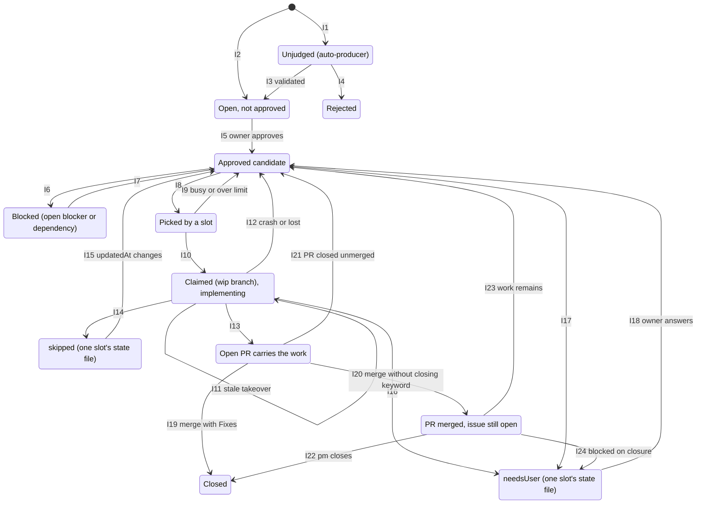
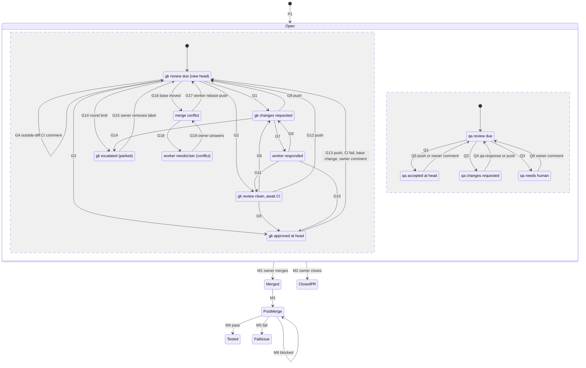
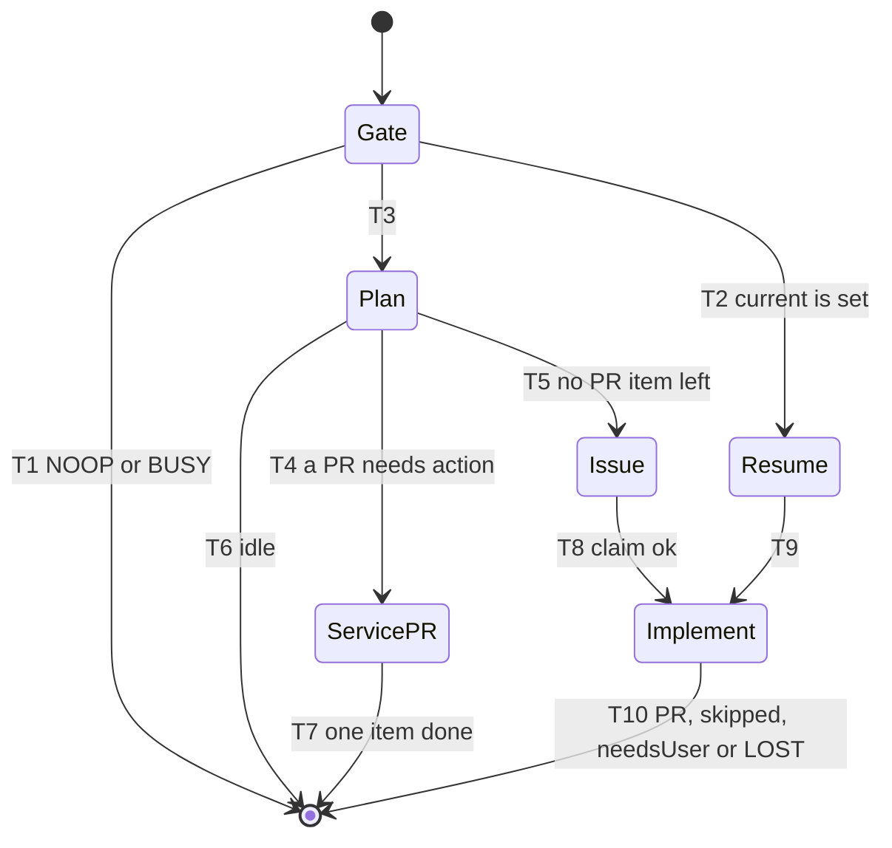

# State model of the devloops loops

This document gives the state machine of an issue and of a pull request across all
loops, and the result of model checking that state machine with TLA+/TLC.

- Spec: [`spec/devloops.tla`](../spec/devloops.tla)
- Main configuration: [`spec/devloops.cfg`](../spec/devloops.cfg)
- All runs: [`spec/run-tlc.sh`](../spec/run-tlc.sh)
- Trace printer: [`spec/trace.py`](../spec/trace.py)

No skill and no code file was changed. Line numbers refer to the tree on which this
document was written (`main` at `f959993`).

Short names in the evidence columns:

| Name | File |
| --- | --- |
| `W` | `skills/worker-loop/SKILL.md` |
| `G` | `skills/gatekeeper-loop/SKILL.md` |
| `Q` | `skills/qa-loop/SKILL.md` |
| `PM` | `skills/pm-loop/SKILL.md` |
| `PR-S` | `skills/producer-loop/SKILL.md` |
| `ESC` | `skills/worker-loop/references/escalation-policy.md` |
| `G-CF` | `skills/gatekeeper-loop/references/comment-format.md` |
| `Q-CF` | `skills/qa-loop/references/comment-format.md` |
| `Q-PM` | `skills/qa-loop/references/post-merge.md` |
| `*.py` | `devloops_lib/*.py` (`cli.py` below is `devloops_lib/forge/cli.py`; `plan_tick.py` is `skills/worker-loop/scripts/plan_tick.py`) |

## 1. State vocabulary

| Where | Name | Meaning | Evidence |
| --- | --- | --- | --- |
| issue label | `auto:producer` | filed by a producer, not yet judged | `contract.py:20`, `PR-S:110` |
| issue label | `validated`, `rejected` | gatekeeper judgement | `contract.py:18-19`, `issue_queue.py:57` |
| issue label | `approved` | owner accepts the scope | `worker_candidates.py:90-91`, `G:81` |
| issue/PR label | `needs-owner` | request for an owner decision | `contract.py:24`, `G:79` |
| forge | open blocker | derived "blocked" state (no label) | `contract.py:70-72`, `worker_candidates.py:100-102` |
| remote branch | `wip/issue-N` | issue claim, a lease with a TTL | `claims.py:267-296` |
| local file | `claims/pr-N` | PR claim for one tick | `claims.py:106-116` |
| slot state | `current`, `needsUser`, `skipped` | worker memory, **one file per slot** | `W:25-37`, `config.py:514-525` |
| PR label | `gatekeeper:changes-requested` / `approved` / `escalated` | verdict labels, one at a time | `contract.py:28-50`, `G-CF:165` |
| PR label | `gatekeeper:review-clean` | extra label while CI runs | `G-CF:137-145` |
| PR label | `gatekeeper:needs-human` | "a human merges this"; never blocks | `G:87`, `G-CF:136` |
| PR label | `qa:accepted` / `changes-requested` / `needs-human` | qa verdict labels | `Q-CF:71-77` |
| PR marker | `gatekeeper-loop: round= verdict=changes-requested/approve/escalate`, `verdict=clean` | verdict bound to a head SHA | `contract.py:109-134`, `G-CF:23-111` |
| PR marker | `worker-loop: response` / `qa-response` / `note` | worker answers | `contract.py:120`, `W:103-105` |
| PR marker | `qa-loop: kind=verdict` | qa verdict bound to a head SHA | `Q-CF:9-54` |
| PR comment | no marker, by owner or `@me` | "owner comment" for all three classifiers | `gatekeeper_queue.py:166-178`, `pr_status.py:336-350`, `qa.py:64-74` |

## 2. Issue lifecycle

Edge labels are transition IDs of the table in section 5.



## 3. Pull request lifecycle

The two reviewers are independent, so an open PR has two concurrent regions.



## 4. Actor view: one worker tick



The gatekeeper tick is: lock, queue, review each `review` PR (at most 5), validate at
most one producer issue, unlock (`G:55-194`). The qa tick is: lock, judge open PRs,
find merged PRs, test them, unlock (`Q:63-137`). The pm tick only plans which of these
ticks to start (`PM:117-140`, `pm_schedule.py:119-157`).

## 5. Transition tables

### 5.1 Issue

| ID | From | Event / actor | Guard | To | Evidence |
| --- | --- | --- | --- | --- | --- |
| I1 | – | producer files a finding | fingerprint new, under the cap | Unjudged | `PR-S:92-110`, `file_issue.py:121-146` |
| I2 | – | gatekeeper gap issue, qa failure issue, or a human | no `approved` label | Open | `G:73-81`, `Q-PM:36-49` |
| I3 | Unjudged | gatekeeper validates | at most 1 per tick; not yet judged | Open (`validated`) | `G:169-190`, `issue_queue.py:45-67,180-197` |
| I4 | Unjudged | gatekeeper rejects | same | Rejected | `G:177-190`, `worker_candidates.py:92-93` |
| I5 | Open | owner adds `approved` | only a human | Candidate | `PM:36`, `G:188`, `worker_candidates.py:90-91` |
| I6 | Candidate | blocker or dependency appears | open forge blocker, `Depends on #N` = `wait`, parent/epic | Blocked | `worker_candidates.py:100-109`, `issue_candidates.py:68-113` |
| I7 | Blocked | blocker closes | recomputed each run | Candidate | `contract.py:101-106`, `W:135` |
| I8 | Candidate | worker plans and re-checks | no PR item left, not skipped, no open closing PR | Picked | `plan_tick.py:76-101,116-123`, `issue_candidates.py:183-189`, `W:79-82` |
| I9 | Picked | claim refused | live claim of another slot, or `OVER LIMIT` | Candidate | `claims.py:292-293,433-438`, `W:152-153` |
| I10 | Picked | worker claims | free, released, own or stale claim (open PRs are **not** checked) | Claimed | `claims.py:276-295`, `W:150-155` |
| I11 | Claimed | another slot takes over | claim not refreshed within TTL | Claimed (new owner) | `claims.py:288-291`, `W:151` |
| I12 | Claimed | crash; `LOST` in the guard | orphan claim expires; the old owner cannot push | Candidate | `guard.py:47-62,147-150`, `W:58,171` |
| I13 | Claimed | `pr create` through the guard, claim released | claim still owned | HasPR | `W:158`, `guard.py:55-60` |
| I14 | Claimed | implementation fails twice or scope explodes | comment on the issue only "if useful" | Skipped | `W:160`, `W:143` |
| I15 | Skipped | issue `updatedAt` changes | per slot | Candidate | `worker_candidates.py:124-135`, `W:167-169` |
| I16 | Claimed | worker records `needsUser` | ambiguity, missing capability, irreversible action | NeedsUser | `ESC:34-49`, `W:189-190` |
| I17 | Candidate | worker records `needsUser` | undecided options, or blocked on closure | NeedsUser | `W:136,140` |
| I18 | NeedsUser | owner answers | "until the user answers" | Candidate | `W:78` |
| I19 | HasPR | owner merges; the forge closes the issue | `Fixes #N` in the body | Closed | `W:158`, `skills/gatekeeper-loop/references/review-rubric.md:20` |
| I20 | HasPR | owner merges a partial PR | `Refs #N` | MergedOpen | `W:141`, `skills/gatekeeper-loop/references/review-rubric.md:20` |
| I21 | HasPR | owner closes the PR | only open PRs exclude an issue | Candidate | `issue_candidates.py:150-157,186-187` |
| I22 | MergedOpen | pm closes the issue | a merged PR links it by keyword **or branch suffix** | Closed | `PM:142-148`, `issue_close.py:66-72,115-155` |
| I23 | MergedOpen | worker picks it again | still `approved`, no open PR | Candidate | `issue_candidates.py:183-189` |
| I24 | MergedOpen | stacked child merged into a parent branch | issue not auto-closed | NeedsUser | `pr_status.py:197-230`, `W:136` |

No loop closes a rejected issue (`G:189`); the owner does.

### 5.2 Pull request, gatekeeper axis

`status` is the result of `gatekeeper_queue.classify` (`gatekeeper_queue.py:348-438`).

| ID | From | Event / actor | Guard | To | Evidence |
| --- | --- | --- | --- | --- | --- |
| P1 | – | worker opens the PR | claim owned | Open | `W:158` |
| G1 | review due | gatekeeper `changes-requested` | a blocker/major finding or a CI failure the diff caused | changes requested; labels swapped, `review-clean` removed | `G:140`, `cli.py:117-122` |
| G2 | review due | gatekeeper `clean` | no required finding, CI pending | await CI; `review-clean` added, `changes-requested` removed; not a round | `G:145`, `cli.py:98-111`, `gatekeeper_queue.py:136-145` |
| G3 | review due | gatekeeper `approve` | no finding, `ciPending` and `ciFailing` empty, mergeable | approved | `G:141`, `cli.py:117-121` |
| G4 | review due | gatekeeper plain comment | CI failure outside the diff | review due (see F2) | `G:93,140`, `gatekeeper_queue.py:166-178,382-383` |
| G5 | await CI | CI finishes green | required checks succeeded | approved | `G:145`, `gatekeeper_queue.py:419-434` |
| G6 | await CI | CI fails because of the diff | – | changes requested | `G:93`, `gatekeeper_queue.py:420-421` |
| G7 | changes requested | worker answers every G item | same round number | responded (`status: review`) | `W:103`, `G-CF:113-127`, `gatekeeper_queue.py:402-405` |
| G8 | changes requested | push without response | new head | review due | `gatekeeper_queue.py:416-417` |
| G9 | responded | gatekeeper requests changes again | open finding | changes requested | `G:134,140` |
| G10 | responded | gatekeeper approves | as G3 | approved | `G:134,141` |
| G11 | responded | gatekeeper posts clean | as G2 | await CI (but see O3) | `G:145` |
| G12 | await CI | push | stale `review-clean` removed | review due | `gatekeeper_queue.py:331-345,567-584` |
| G13 | approved | push, base change, CI failure, owner comment | – | review due; stale label removed | `G:95,201`, `gatekeeper_queue.py:382-396` |
| G14 | any not approved | round limit reached | `rounds >= max_rounds`; label first, then marker | escalated | `G:96,146`, `gatekeeper_queue.py:376-400` |
| G15 | escalated | owner removes the label | an owner comment alone does nothing | review due, rounds restart | `G:96,146`, `gatekeeper_queue.py:148-163,514-538` |
| G16 | any | base moves | `CONFLICTING` | merge conflict (`wait-worker`) | `gatekeeper_queue.py:379-380` |
| G17 | conflict | worker resolves and force-pushes | mechanical conflicts only | review due | `W:101`, `pr_status.py:257-258` |
| G18 | conflict | worker records `needsUser` | non-mechanical hunk | needsUser | `W:101` |
| G19 | needsUser | owner answers | – | conflict | `W:78` |

Worker actions that change a PR, in priority order (`pr_status.py:239-271`; one item per
tick, `W:182`, `plan_tick.py:76-101`):

| ID | `nextAction` | Guard | Effect | Evidence |
| --- | --- | --- | --- | --- |
| W0 | `none` | `gatekeeper:escalated` present | parked | `pr_status.py:253-254`, `G:146` |
| W1 | `retarget` | parent PR merged | base change and push (G13/Q5) | `W:100`, `pr_status.py:138-161` |
| W2 | `resolve-conflict` | `CONFLICTING` | G17 or G18 | `W:101` |
| W3 | `restack` | duplicate commits | push | `W:102`, `pr_status.py:71-84` |
| W4 | `address-gatekeeper` | latest verdict is CR at head, no response | G7 (push or decline) | `W:103`, `pr_status.py:87-109` |
| W5 | `address-qa` | qa CR at head, no `qa-response` | Q4 | `W:105`, `pr_status.py:112-135` |
| W6 | `triage-comments` | unresolved thread, or unmarked comment newer than the last commit | push, or reply | `W:106`, `pr_status.py:336-350` |
| W7 | `fix-ci` | any failing check run | push, or rerun for infrastructure only | `W:107-110`, `pr_status.py:293-295` |
| W8 | `wait-ci` / `none` | pending or clean | nothing | `pr_status.py:269-271` |

### 5.3 Pull request, qa axis

| ID | From | Event / actor | Guard | To | Evidence |
| --- | --- | --- | --- | --- | --- |
| Q1 | review due | qa `accepted` | every criterion has a test path | accepted | `Q:87`, `qa.py:109-110` |
| Q2 | review due | qa `changes-requested` | a missing test path the worker can add | changes requested | `Q:88,97`, `qa.py:105-106` |
| Q3 | review due | qa `needs-human` | manual only, blocked tool, declined twice, loop skill | needs human | `Q:89,111-112,160`, `qa.py:107-108` |
| Q4 | changes requested | `qa-response`, or a new head | – | review due | `Q:97`, `qa.py:99-104` |
| Q5 | accepted | push, or unmarked owner comment | – | review due | `Q:153`, `qa.py:99-102` |
| Q6 | needs human | owner comments | a bare label change does nothing | review due | `Q:113`, `qa.py:101-102` |

### 5.4 Merge and after

| ID | From | Event / actor | Guard | To | Evidence |
| --- | --- | --- | --- | --- | --- |
| M1 | open | owner merges | by convention: `signoff` is green. Nothing enforces it | merged | `Q:139-153`, `qa.py:130-161`, `W:183`, `PM:36` |
| M2 | open | owner closes | no loop closes a PR | closed | `G:205` |
| M3 | merged | qa queues it | merged after the cursor | pending test | `Q:115-121`, `qa.py:184-211` |
| M4 | pending test | build and tests pass | – | tested | `Q:127-132`, `qa.py:214-228` |
| M5 | pending test | a check fails | file one issue, never `approved` | tested, new issue (I2) | `Q:133`, `Q-PM:36-49` |
| M6 | pending test | blocked tool or not in the build | – | pending test | `Q-PM:34`, `qa.py:222-224` |

### 5.5 Worker tick

| ID | Transition | Evidence |
| --- | --- | --- |
| T1 | gate answers `NOOP` or `BUSY` | `W:73-75`, `tick_gate.py:1171-1189` |
| T2, T9 | `current` set: run and resume | `W:37,77`, `tick_gate.py:1157-1166` |
| T3 | build one plan | `W:79` |
| T4, T7 | PR items first, `maxItems` per tick | `W:79,182`, `plan_tick.py:76-101` |
| T5, T8 | issue item, claim | `W:115-155` |
| T6 | open PR limit or nothing to do | `W:119`, `issue_candidates.py:116-122` |
| T10 | PR opened, skip, needsUser, or `LOST` | `W:58,158-160` |

## 6. Model scope

The TLA+ model has the actors worker (1 or 2 slots), gatekeeper, qa, pm, owner, plus CI
and the base branch as environment. The producer appears only as the source of
unjudged issues (the initial state).

Abstractions:

- A head SHA is not stored. "Marker is at the current head" is a boolean; a push clears it.
- Each environment event (`defect`, `ownerComment`, `conflict`, `ciFail`, `baseBreak`,
  `cancelled`, `qaFinding`, `qaHuman`, `needsUser`, `implFail`, `stale`, `crash`,
  `partial`, `rejected`, `blocker`) happens at most once per behaviour. Each run enables a
  named subset (`Env`), so a "pass" holds for that subset and for these bounds only.
- Bounds: 1 or 2 issues, 1 or 2 worker slots, `MaxRounds` 1 or 2 (the default in code is 5).
- A gatekeeper review is two steps (`check-head`, then post), so a push can fall between.
  A worker PR action and a qa review are one step each.
- A stale-head verdict is judged with the new head's data; only its `head=` is stale.
- `BaseFixed` stands for the whole gap-issue, approval and merge flow.
- `PmSlots = 1` is the smallest pm budget. With 3 or more slots every role is started.
- Not modelled: stacked PRs (retarget, restack), draft PRs, the open PR limit, base
  changes, the idle memo of the tick gate, post-merge testing, producer deduplication,
  the `gatekeeper:needs-human` label, the second escalation reason (parked owner
  decision), the qa "declined twice" counter, several gatekeeper or qa instances
  (declared unsupported, `skills/worker-loop/references/scheduling.md:86-90`).

Fairness (`LiveSpec`): strong fairness for the worker's PR/pick step, the gatekeeper
verdict step and the qa review; weak fairness for implementation, label cleanup, owner
actions (approve, answer, remove escalation, check and merge), CI completion, blocker
close, claim expiry and the base fix. `NoMergeSpec` is the same without the owner's
check and merge: the worker skill says that a PR waiting for a merge must not stop issue
work (`W:117`). Failures, crashes and owner comments have no fairness.

`Fixes` is a set of **hypothetical** changes that exist only in the model. `Fixes = {}`
is the model of the code as it is. A violation that disappears with exactly the named
fix confirms which behaviour causes it.

| Fix name | Hypothetical change |
| --- | --- |
| `claimRecheck` | the issue claim is refused when an open PR already closes the issue |
| `sharedPark` | `needsUser` and `skipped` are shared by all slots |
| `skipAsks` | "failed twice" also asks the owner |
| `requiredBeforeApprove` | no approve until the required checks passed (post `clean` first) |
| `markedNotes` | gatekeeper comments carry a marker |
| `parkOutsideFailure` | "reviewed, CI broken outside the diff" leaves the review queue |
| `triageAck` | an answered PR comment stops being new |
| `workerEffectiveCI` | the worker ignores superseded runs and base breaks it cannot fix yet |
| `atomicLabels` | a verdict label swap is one write |
| `matchHead` | the merge applies only to the head that `signoff` checked |
| `signoffStrict` | `signoff` also needs green CI and no escalation |
| `roundCap` | no verdict after the round limit |
| `pmEscalate` | pm counts an unlabelled `escalate` PR as review work |
| `pmSkipParked` | pm does not count parked issues as worker backlog |
| `partialStaysOpen` | pm does not close an issue for a partial PR |

## 7. Findings

### 7.1 Result per requested property

| Requested property | Model name | Result, code as it is | With model-only fixes |
| --- | --- | --- | --- |
| Type correctness | `TypeOK` | holds | holds |
| No merge without gatekeeper approve and qa pass at the same head | `MergedOnlyWithSignoffs` | **violated** (F6) | holds |
| – and only when green | `MergedOnlyGreen` | **violated** (F5, F6) | holds |
| – no approve before required checks | `ApproveOnlyWithRequiredChecks` | **violated** (F5) | holds |
| No two verdict labels at once | `OneVerdictLabel` | **violated**, transiently (F7); `OneVerdictLabelSettled` holds | holds |
| No silent stall / every parked state has an exit | `NoSilentStall` | **violated** (F1, F11) | holds |
| Approved unblocked issue gets a PR or an owner question | `IssueProgress` | **violated** (F1, F3, F4) | holds |
| An open PR is merged or the owner is asked | `PRProgress` | **violated** (F2, F3, F12) | holds |
| Every PR gets a qa verdict | `QaProgress` | **violated** under pm (F12) | holds |
| A PR at the round limit gets escalated | `EscalationHappens` | **violated** under pm (F11) | holds |
| Owner needed only in explicit owner states | `OwnerOnlyExplicit` | **violated** (F14) | **violated** (F14) |
| No issue claimed by two workers | `OnlyOneMayPush`, one claim value (`TypeOK`) | holds | holds |
| – no two workers implement one issue | `OneImplementer` | **violated** after a stale claim (F15) | **violated** (F15) |
| One open PR per issue | `NoDuplicatePR` | **violated** (F8) | holds |
| Parked work stays parked | `ParkedStaysParked` | **violated** (F9) | holds |
| Round limit respected | `RoundLimit` | **violated** (F10) | holds |
| Issue closed only when complete | `ClosedOnlyWhenComplete` | **violated** (F13) | holds |

"Holds" means: no violation in the bounded runs of section 8.

Deadlock: TLC's deadlock check is off, because a merged and closed item is a legitimate
final state. `NoSilentStall` and the liveness properties replace it.

### 7.2 Classification summary

| ID | Finding | Class |
| --- | --- | --- |
| F1 | A skipped issue stalls for ever and nobody is asked | real design defect |
| F2 | The gatekeeper's own plain comment reads as an owner comment | spec/code mismatch |
| F3 | A PR comment that needs no commit stays "new" and starves other work | real design defect |
| F4 | A superseded run makes the worker try `fix-ci` for ever | spec/code mismatch |
| F5 | Approve (and merge) before the required checks ran | spec/code mismatch |
| F6 | The merge gate is not bound to the merged head | real design defect |
| F7 | Two verdict labels between add and remove | real design defect (transient, low) |
| F8 | Two PRs for one issue | real design defect (narrow race) |
| F9 | `needsUser` is invisible to other slots | real design defect |
| F10 | Verdicts after the round limit | spec/code mismatch |
| F11 | Under pm nobody escalates a PR at the round limit | spec/code mismatch |
| F12 | pm with one slot starves qa and the worker | real design defect |
| F13 | pm closes an issue after a partial PR | spec/code mismatch |
| F14 | The owner is needed outside explicit owner states | spec/code mismatch against D-015 to D-017 (known, not implemented) |
| F15 | Two workers implement one issue after a stale claim | modelling artefact (property stronger than the design promises) |

"Checked directly" in a finding means: the named `devloops_lib` function was also
called with a hand-made input and returned the stated result. Nothing was run against a
live forge.

State numbers in the traces are those of the TLC output. `w1`, `w2` are worker slots.
The numbers below are from the run recorded in section 8. TLC uses parallel workers, so
a later run can print a different but equivalent trace (for example with the two issue
numbers exchanged). The traces are shortened to the steps that matter.
Reproduce any trace with `spec/run-tlc.sh <run>` and
`python3 -I spec/trace.py spec/states/logs/<run>.log`.

### F1. A skipped issue stalls for ever (real design defect)

Runs `stall-skip` (`NoSilentStall`), `live-skip` (`IssueProgress`).

```text
3 OwnerApprove      approved=TRUE
4 Pick              w1 picks issue 1
5 Claim             w1 claims
6 ImplFail          claim free, skip={w1}
7 Stuttering        for ever: no loop acts, the owner is not asked
```

- `W:160`: record `skipped`, and "comment on the issue only if useful to humans".
- `worker_candidates.py:124-135`, `issue_candidates.py:184-185`, `tick_gate.py:823`:
  the entry hides the issue while `updatedAt` is unchanged.
- `W:165` requires a report of new `needsUser` items; no rule requires a report of a new
  `skipped` entry. The issue keeps `approved` and looks queued.
- The trace is the case without a comment. A comment posted after the entry is recorded
  moves `updatedAt` and wakes the issue again, without asking the owner anything.
- Bound: with N slots each slot must fail once; the run uses one slot.
- `skipAsks` removes both violations (`one-stall-skip`, `one-live-skip`).

### F2. A plain gatekeeper comment counts as an owner comment (spec/code mismatch)

Runs `live-base-break`, `live-owner-comment` (`PRProgress`), `live-pm-base-break`.

```text
7  GkCheck     first review of PR 1
8  CiDone      ci=base (the base branch is broken)
9  GkWrite     plain comment: gNew, wNew="info", qNew
11 QaReview    accepted
12 BaseFixed   base is fine again; the PR keeps the old red result
13 GkWrite     plain comment again
14 QaReview    reviews again
   Back to state 12: the PR is never rebased, never merged
```

- `G:93,140`: a failure outside the diff gets "a plain comment". `G:93` and `G:81` also
  tell the gatekeeper to comment for stalled checks and gap issues.
- `G-CF:5-111` defines no marker for such a note (`contract.py:119`: only
  `needs-owner`).
- `G-CF:163`, `gatekeeper_queue.py:166-178`: every unmarked `@me` comment is an owner
  comment. So `classify` returns `review` for ever (`gatekeeper_queue.py:382-383`), qa
  reviews again (`qa.py:101-102`), and the worker sees a new comment
  (`pr_status.py:336-350`).
- The worker's `triage-comments` ranks above `fix-ci` (`pr_status.py:265-268`), so the
  rebase onto the repaired base never starts.
- One such comment is enough: it stays "new" until a commit. The model repeats it only
  because the gatekeeper's status stays `review`.
- The model lets the worker rebase once the base is repaired
  (`skills/worker-loop/references/stacked-prs.md:3` allows it when the needed change is
  in the base). An agent that rebases while triaging the comment would leave the loop;
  no skill text tells it to.
- Single-fix runs: `markedNotes` alone removes the trace without pm and without an owner
  comment (`one-live-base-marked`). With an owner comment it also needs `triageAck`
  (`one-live-comment-marked` fails, `one-live-comment-both` passes). Under pm it also
  needs `parkOutsideFailure` (F12).

### F3. A comment without a commit starves other work (real design defect)

Run `live-starve-comment` (`IssueProgress`, `NoMergeSpec`, 2 issues).

```text
6-8   w1 implements issue 2 and opens PR 2
11    OwnerComment     an informational comment on PR 2
12    QaReview         accepted
13    GkWrite          approve (the gatekeeper has answered the comment)
14    OwnerCheck       PR 2 is merge-ready
15    Stuttering       PR 2 stays "triage-comments"; approved issue 1 is never picked
```

- `pr_status.py:336-350`: a comment is new while it is newer than the last commit. A
  worker reply with a `note` marker does not change that.
- `W:106`: "reply with reasoning to rejected ones". The reply produces no commit.
- `plan_tick.py:76-101`, `W:182`: PR items come first, one item per tick. Every tick
  spends its item on the same comment. `W:117` says a waiting PR must not stop issue work.
- The same priority hides `fix-ci` on that PR (`pr_status.py:265-268`).
- `triageAck` removes it (`one-starve-comment`).
- The trace assumes that the agent counts the replied comment as its item. The scripts
  give it no other signal: the item is in every later plan.
- Limit: with k stuck PRs and `max_items_per_tick = 1`, one slot is enough to show it.
  A larger `maxItems` only raises the number of stuck PRs needed.

### F4. A superseded run keeps the worker in `fix-ci` (spec/code mismatch)

Run `live-starve-superseded` (`IssueProgress`, `NoMergeSpec`).

```text
8     PR 2 open
12    Supersede    PR 2 has a cancelled run that a successful run replaced
13    GkWrite      approve (the gatekeeper ignores the superseded run)
15    Stuttering   nextAction = fix-ci for ever; approved issue 1 is never picked
```

- `gatekeeper_queue.py:283-309,501-504`: only the latest run of a required check counts.
- `pr_status.py:293-295`: the worker counts every run, `CANCELLED` is a failure
  (`pr_status.py:53`).
- `W:108`: never rerun a job just to get green. There is nothing to reproduce.
- Checked directly: for `[CANCELLED, later SUCCESS]` of one required check the
  gatekeeper list of failures is empty and the worker list is not.
- `workerEffectiveCI` removes it (`one-starve-superseded`).

### F5. Approve before the required checks ran (spec/code mismatch)

Runs `gated-approve`, `merge-green-matchhead` (`Gated = TRUE`).

```text
6   CreatePR     required check gated on gatekeeper:review-clean: not run
9   CiDone       the other checks pass
10  GkWrite      approve (first review, nothing pending, nothing failing)
11  OwnerCheck   signoff: merge-ready
12  OwnerMerge   merged; the required check never ran
```

- `templates/devloops.config.yaml:63`: `required_checks` "must pass before approve".
- `G-CF:141-161`: expensive jobs are gated on the `review-clean` label.
- `G:141`: approve needs only empty `ciPending` / `ciFailing`. A gated job is `SKIPPED`
  or absent, which is neither.
- `gatekeeper_queue.py:419-429` waits for missing required checks only on the
  `clean` path; the first review and `approved` (`:391-396`) ignore them, and the queue
  output has no field for them (`:622-652`).
- `cli.py:117-121`: `set-verdict approved` does not add `review-clean`, so the gated job
  is never triggered.
- `qa.py:130-161`: `signoff` does not look at CI.
- Checked directly: with `required_checks: [macos]` and a `SKIPPED` run, a current-head
  approve classifies as `approved`.
- `requiredBeforeApprove` removes it (`one-gated-approve`).

### F6. The merge gate is not bound to the merged head (real design defect)

Runs `merge-signoff`, `merge-green` (owner uses `signoff`), `merge-labels`.

```text
8-10   qa accepted and gatekeeper approve on head A, CI green
11     OwnerCheck    signoff: merge-ready
12-13  Conflict; the worker rebases and pushes head B
14     OwnerMerge    head B merged: no sign-off, CI pending
```

With labels only (`merge-labels`):

```text
7      GkCheck       gatekeeper re-checked head A
9-10   owner comment; the worker pushes head B
12     GkWrite       approve marker for A, label gatekeeper:approved lands on B
14     OwnerMerge    by labels: B merged without a gatekeeper approve
```

- `Q:139-153`, `qa.py:130-161`: `signoff` is advisory. Nothing passes the checked SHA to
  the merge, and no step sets branch protection.
- `G:148-154`: `check-head` and the label write are separate calls.
- `qa.py:130-161` also ignores CI, `gatekeeper:escalated`, `needs-owner` and owner
  comments posted after the approve. Checked directly: a PR with a failing check and an
  owner "do not merge" comment returns `mergeReady: True`.
- `matchHead` alone restores `MergedOnlyWithSignoffs` (`merge-signoff-matchhead`); green CI
  also needs `signoffStrict` (`one-merge-matchhead-strict`) and F5.
- The owner is a human: the model lets any time pass between check and merge.

### F7. Two verdict labels at once (real design defect, transient)

Run `labels-two`.

```text
7   QaReview   changes-requested, label qa:changes-requested
8   WorkerPR   declines (qa-response)
9   QaReview   accepted: labels {cr, accepted}
```

- `Q-CF:81-83`: `label add X && label remove Y Z`, two writes. If the second fails, both
  stay until `staleLabels` repairs them (`qa.py:112-113`, `Q:95`).
- `cli.py:120-121`: the gatekeeper does the same (add, then remove).
- `OneVerdictLabelSettled` (no pending second write) holds. `atomicLabels` removes the
  transient state. A consumer that reads labels only (the open PR limit,
  `claims.py:92-95`; the owner) can see both.
- Issue labels `validated` / `rejected` never overlap in the model (one gatekeeper,
  `issue_queue.py:57`). `apply_verdict` itself does not remove the opposite label
  (`issue_queue.py:180-197`), so a manual second call would add both.

### F8. Two PRs for one issue (real design defect, narrow race)

Run `dup-pr` (2 slots, no failures at all).

```text
3     w1 picks issue 1
4     w1 claims
5     w2 picks issue 1 (no PR yet)
6     w1 opens the PR, releases the claim
7     w2 claims the now free issue
8     w2 opens a second PR
```

- `W:82` checks the issue before the claim; between the two the worker reads the whole
  issue (`W:130`).
- `claims.py:276-295`: a released claim is granted without a look at open PRs, and
  `CLAIMED` names the previous work branch (`W:151`).
- The forge refuses a second PR only for the same head branch.
- `claimRecheck` removes it, also with stale claims and crashes (`one-dup-pr*`).

### F9. `needsUser` is per slot (real design defect)

Run `parked-slot`.

```text
5   ImplAsk   w1 records needsUser for issue 1, releases the claim
6   Pick      w2 picks the same issue
```

- `config.py:514-525`: each slot has its own `state.json`.
- `W:78` "Skip items in needsUser until the user answers"; `W:25-37` stores it there.
- No script reads `needsUser`: `plan_tick.py:76-101` and `tick_gate.py:783-869` do not
  filter it, so even the same slot relies on the agent to skip it.
- `sharedPark` removes it (`one-parked`).

### F10. Verdicts after the round limit (spec/code mismatch)

Run `round-limit` (`MaxRounds = 2`).

```text
7     GkWrite       changes-requested, round 1
8     WorkerPR      declines
10    GkWrite       changes-requested, round 2 = limit
11    OwnerComment
13    GkWrite       a third verdict
```

- `G:146`: at the limit the verdict is `escalate`.
- `gatekeeper_queue.py:382-383` returns `review` for an owner comment before the limit
  test at `:398-400`; `:391-396` does the same for CI failure or base change after an
  approve. A plain gatekeeper comment (F2) takes the same path.
- `roundCap` removes it (`one-round-limit`).

### F11. Under pm nobody escalates (spec/code mismatch)

Runs `stall-pm-escalate` (`NoSilentStall`), `live-pm-escalate` (`EscalationHappens`).

```text
8     GkWrite     changes-requested = round limit (MaxRounds 1)
9     WorkerPR    pushes a fix and answers
10-11 qa accepts, CI passes
      NoSilentStall is violated: status "escalate", no label, no loop is started,
      owner not asked
```

- `G:96`: when the status is `escalate` and the label is missing, the **gatekeeper tick**
  adds label and verdict.
- `pm_pipeline.py:41,56-73,91,96`: status `escalate` is "parked", counted nowhere.
- `pm_schedule.py:142-144`: the gatekeeper is started only for `prsNeedingReview > 0`.
- The escalation happens only if some other PR starts the gatekeeper. This does not
  depend on the slot count. Checked directly: for one entry with status `escalate`,
  `cascade_plan` with 3 slots returns an empty plan.
- `pmEscalate` removes it (`stall-pm-escalate-fixed`, `one-pm-escalate`).

### F12. pm with one slot starves roles (real design defect)

Runs `live-pm-qa` (`QaProgress`), `live-pm-base-break` (`PRProgress`).

```text
live-pm-qa
8     PR 2 open
11    GkWrite     approve
12    Supersede   the worker now has a permanent backlog (F4)
13    Stuttering  qa is never started for PR 2

live-pm-base-break
7-9   gatekeeper review of a PR whose CI is broken by the base; plain comment
10    BaseFixed
11    GkCheck, then back to 10: status stays "review"; only the gatekeeper is ever started
```

- `pm_schedule.py:142-153`: fixed order gatekeeper, worker, qa inside the slot cap, with
  no ageing.
- `gatekeeper_queue.py:436-438`: a PR with an outside CI failure and no verdict stays
  `review`, even if the comment had a marker (`one-pm-base-marked` still fails).
- `pm_pipeline.py:85-88`: issues in `needsUser` still count as worker backlog.
- `parkOutsideFailure` or `workerEffectiveCI` remove the permanent backlog
  (`one-pm-base-park`, `one-pm-qa`). A permanent backlog of another kind would starve
  the later roles again: the order itself has no fairness.
- Applies when the slot budget is smaller than the number of roles with work.

### F13. pm closes an issue after a partial PR (spec/code mismatch)

Run `partial-close`.

```text
5     CreatePR     partial work, body "Refs #N", branch <type>/<slug>-N
11    OwnerMerge   issue stays open, as intended
12    PmClose      pm closes it
```

- `W:141`: large issues are implemented one checklist item at a time. Rubric:
  partial work must use `Refs #N`.
- `PM:142-148` closes what is "judged complete"; `issue_close.py:10,66-72` links an
  issue by the branch suffix too, and `merged_pr` is the default signal for software.
- `W:150` requires the issue number in every branch name.
- Checked directly: a merged PR "Refs #123" on `feat/x-123` makes #123 closable.
  The pattern needs 3 or more digits.
- `partialStaysOpen` removes it (`one-partial`).

### F14. The owner is needed outside explicit states (known mismatch)

Run `owner-routine`, also with all fixes (`fix-owner-routine`).

```text
2     GkValidate   the issue is validated; only the owner can move it (add approved)
```

The second routine case is every merge-ready PR (`W:183`, `Q:19`, `PM:36`).

- D-015 (pm merges), D-016 (only blocked and decision items reach the owner) and D-017
  (`blocked:owner`, `decision:owner`) are in `docs/decisions.md:172-199`, and
  `docs/decisions.md:201-217` records that `main` does not implement them. D-015 and
  D-017 wait for owner confirmation.
- The labels `decision:owner` and `blocked:owner` do not exist. The model takes
  `needsUser`, `gatekeeper:escalated` and `qa:needs-human` as the explicit states.
  `needsUser` is only local state and a tick report.
- `NoSilentStall` is the same test with approval and merge allowed. With all fixes it
  holds, so these two routine steps are the only other owner dependencies the model has.

### F15. Two implementers after a stale claim (modelling artefact)

Runs `claim-two-impl`, `fix-claim-stale`.

```text
4     w1 claims and implements
5     w2 picks the same issue
6     the claim TTL passes
7     w2 takes the claim over; w1 does not know yet
```

This is the intended lease (`claims.py:20-24,288-291`, `W:58,151`). The claim has one
owner, and `guard.py:47-62` stops the old owner at its next push
(`OnlyOneMayPush` holds). The requested property "no issue claimed by two workers"
**holds**; `OneImplementer` asks for more than a lease can give. Without `stale` it holds
(`claim-no-env`). The remaining cost is duplicated work.

### 7.3 Modelling artefacts found and corrected

These came from the model and were fixed in it; none is counted as a finding.

| Artefact | Correction |
| --- | --- |
| `IssueProgress` reported an approved issue that the gatekeeper then rejected | the consequent now accepts "not live any more" |
| a conflict rebase removed a code defect | a rebase keeps `defect` |
| CI passed on a head pushed while the base was broken | such a head fails with `base` |
| merge runs with `Env = {}` passed because nothing could push after the approve | the runs enable `conflict` |
| the first fix set still looped under pm (`markedNotes` alone) | `parkOutsideFailure` added; recorded in F12 |

### 7.4 Observations from code reading (no model run)

| ID | Observation | Class | Evidence |
| --- | --- | --- | --- |
| O1 | `signoff` accepts a PR with failing CI, `needs-owner` and a later owner comment (checked directly) | real design defect, part of F6 | `qa.py:130-161` |
| O2 | `W:105` says the qa round "stays open until answered separately"; after the gatekeeper-driven push the worker is no longer asked, qa just reviews the new head (checked directly) | spec/code mismatch, no stall | `pr_status.py:130-134`, `qa.py:99-100` |
| O3 | `clean` after a response on the same head still classifies as `review`, so the diff is reviewed again each tick until CI ends, against `G:86,200` (checked directly) | spec/code mismatch | `gatekeeper_queue.py:402-405` before `:413-434` |
| O4 | an `approved` issue with `needs-owner` is still a worker candidate; `contract.first_state` ranks `needs-owner` first but nothing calls it; only pm parks it | spec/code mismatch, D-017 pending | `worker_candidates.py:62-109`, `contract.py:65-98`, `pm_pipeline.py:40` |
| O5 | the second escalation reason ("decision the worker parked") has no channel: `needsUser` is local and the worker skill posts no `needs-owner` marker | real design defect | `G:146`, `contract.py:120`, `W:78,103-105` |

## 8. Runs, bounds and states explored

`spec/run-tlc.sh` runs all of the following with TLC 2.19 (tla2tools v1.7.4, Java 8).
`expected=fail` rows are counterexample runs: TLC stops at the first violation, so their
state counts are partial. `pass` rows explored the complete state graph of their
configuration.

### Safety that holds, code as it is

| Run | Properties | Expected | Result | States generated | Distinct states |
| --- | --- | --- | --- | ---: | ---: |
| `main-typeok-issue` | TypeOK OnlyOneMayPush | pass | pass | 20,190,647 | 3,264,546 |
| `main-typeok-env` | TypeOK OnlyOneMayPush | pass | pass | 1,923,853 | 332,529 |
| `main-typeok-qa` | TypeOK OnlyOneMayPush | pass | pass | 846,260 | 161,446 |
| `main-typeok-pm` | TypeOK | pass | pass | 1,371,050 | 457,472 |

### Safety scenarios, code as it is

| Run | Properties | Expected | Result | States generated | Distinct states |
| --- | --- | --- | --- | ---: | ---: |
| `merge-signoff` | MergedOnlyWithSignoffs | fail | fail | 726 | 210 |
| `merge-labels` | MergedOnlyWithSignoffs | fail | fail | 2,022 | 605 |
| `merge-signoff-matchhead` | MergedOnlyWithSignoffs | pass | pass | 4,503,452 | 768,136 |
| `merge-green` | MergedOnlyGreen | fail | fail | 733 | 210 |
| `merge-green-matchhead` | MergedOnlyGreen | fail | fail | 143 | 54 |
| `gated-approve` | ApproveOnlyWithRequiredChecks | fail | fail | 73 | 34 |
| `labels-two` | OneVerdictLabel | fail | fail | 194 | 84 |
| `labels-two-settled` | OneVerdictLabelSettled | pass | pass | 6,887,105 | 1,183,346 |
| `claim-two-impl` | OneImplementer | fail | fail | 119 | 58 |
| `claim-no-env` | OneImplementer | pass | pass | 946 | 268 |
| `claim-may-push` | OnlyOneMayPush | pass | pass | 7,004 | 1,730 |
| `dup-pr` | NoDuplicatePR | fail | fail | 179 | 76 |
| `parked-slot` | ParkedStaysParked | fail | fail | 69 | 36 |
| `round-limit` | RoundLimit | fail | fail | 15,810 | 4,556 |
| `partial-close` | ClosedOnlyWhenComplete | fail | fail | 242 | 84 |
| `stall-skip` | NoSilentStall | fail | fail | 38 | 22 |
| `stall-pm-escalate` | NoSilentStall | fail | fail | 107 | 62 |
| `stall-pm-escalate-fixed` | NoSilentStall | pass | pass | 202 | 92 |
| `owner-routine` | OwnerOnlyExplicit | fail | fail | 2 | 2 |

### Liveness, code as it is

| Run | Properties | Expected | Result | States generated | Distinct states |
| --- | --- | --- | --- | ---: | ---: |
| `live-baseline-issue` | IssueProgress PRProgress QaProgress EscalationHappens | pass | pass | 133 | 48 |
| `live-baseline-review` | IssueProgress PRProgress QaProgress EscalationHappens | pass | pass | 36,505 | 7,724 |
| `live-baseline-qa` | IssueProgress PRProgress QaProgress EscalationHappens | pass | pass | 1,895 | 472 |
| `live-skip` | IssueProgress | fail | fail | 127 | 46 |
| `live-base-break` | PRProgress | fail | fail | 807 | 220 |
| `live-owner-comment` | PRProgress | fail | fail | 39,115 | 7,908 |
| `live-starve-comment` | IssueProgress | fail | fail | 1,159,469 | 138,456 |
| `live-starve-superseded` | IssueProgress | fail | fail | 25,921 | 4,028 |
| `live-nomerge-baseline` | IssueProgress | pass | pass | 11,753 | 1,920 |
| `live-pm-escalate` | EscalationHappens | fail | fail | 116 | 64 |
| `live-pm-qa` | QaProgress | fail | fail | 9,313 | 2,492 |
| `live-pm-base-break` | PRProgress | fail | fail | 164 | 84 |

### All model-only fixes

| Run | Properties | Expected | Result | States generated | Distinct states |
| --- | --- | --- | --- | ---: | ---: |
| `fix-merge` | MergedOnlyWithSignoffs MergedOnlyGreen ApproveOnlyWithRequiredChecks | pass | pass | 2,308,617 | 349,748 |
| `fix-safety-issue` | TypeOK OnlyOneMayPush NoDuplicatePR ParkedStaysParked ClosedOnlyWhenComplete NoSilentStall OneVerdictLabel | pass | pass | 11,969,173 | 1,952,158 |
| `fix-safety-pr-review` | TypeOK MergedOnlyWithSignoffs MergedOnlyGreen ApproveOnlyWithRequiredChecks OneVerdictLabel RoundLimit NoSilentStall | pass | pass | 7,587,890 | 1,076,466 |
| `fix-safety-pr-ci` | TypeOK MergedOnlyWithSignoffs MergedOnlyGreen ApproveOnlyWithRequiredChecks OneVerdictLabel RoundLimit NoSilentStall | pass | pass | 513,442 | 89,702 |
| `fix-safety-pm` | TypeOK NoSilentStall RoundLimit | pass | pass | 21,936 | 8,186 |
| `fix-claim-stale` | OneImplementer | fail | fail | 119 | 56 |
| `fix-owner-routine` | OwnerOnlyExplicit | fail | fail | 2 | 2 |
| `fix-live-issue` | IssueProgress PRProgress QaProgress EscalationHappens | pass | pass | 3,494 | 1,164 |
| `fix-live-comment` | IssueProgress PRProgress QaProgress EscalationHappens | pass | pass | 90,169 | 16,676 |
| `fix-live-ci` | IssueProgress PRProgress QaProgress EscalationHappens | pass | pass | 138,608 | 23,746 |
| `fix-live-rounds` | IssueProgress PRProgress QaProgress EscalationHappens | pass | pass | 130,526 | 25,790 |
| `fix-live-starve-comment` | IssueProgress | pass | pass | 998,749 | 112,496 |
| `fix-live-starve-superseded` | IssueProgress | pass | pass | 26,137 | 4,028 |
| `fix-live-pm` | IssueProgress PRProgress QaProgress EscalationHappens | pass | pass | 1,804 | 834 |
| `fix-live-pm-qa` | QaProgress | pass | pass | 19,781 | 5,204 |

### One fix at a time

| Run | Properties | Expected | Result | States generated | Distinct states |
| --- | --- | --- | --- | ---: | ---: |
| `one-merge-matchhead-strict` | MergedOnlyWithSignoffs MergedOnlyGreen | pass | pass | 1,285 | 300 |
| `one-gated-approve` | ApproveOnlyWithRequiredChecks | pass | pass | 156 | 52 |
| `one-labels` | OneVerdictLabel | pass | pass | 5,956 | 1,214 |
| `one-dup-pr` | NoDuplicatePR | pass | pass | 551 | 164 |
| `one-dup-pr-stale` | NoDuplicatePR | pass | pass | 3,436 | 906 |
| `one-parked` | ParkedStaysParked | pass | pass | 2,280 | 618 |
| `one-round-limit` | RoundLimit | pass | pass | 122,474 | 23,486 |
| `one-partial` | ClosedOnlyWhenComplete | pass | pass | 355 | 120 |
| `one-stall-skip` | NoSilentStall | pass | pass | 249 | 88 |
| `one-live-skip` | IssueProgress | pass | pass | 249 | 88 |
| `one-live-base-marked` | PRProgress | pass | pass | 631 | 172 |
| `one-live-base-triage` | PRProgress | fail | fail | 1,505 | 368 |
| `one-live-comment-marked` | PRProgress | fail | fail | 36,331 | 7,316 |
| `one-live-comment-triage` | PRProgress | fail | fail | 46,023 | 9,008 |
| `one-live-comment-both` | PRProgress | pass | pass | 38,373 | 7,632 |
| `one-starve-comment` | IssueProgress | pass | pass | 1,232,097 | 146,024 |
| `one-starve-superseded` | IssueProgress | pass | pass | 26,137 | 4,028 |
| `one-pm-escalate` | EscalationHappens | pass | pass | 202 | 92 |
| `one-pm-qa` | QaProgress | pass | pass | 9,441 | 2,492 |
| `one-pm-base-marked` | PRProgress | fail | fail | 116 | 60 |
| `one-pm-base-park` | PRProgress | pass | pass | 175 | 96 |

### Sanity (a merge is reachable)

| Run | Properties | Expected | Result | States generated | Distinct states |
| --- | --- | --- | --- | ---: | ---: |
| `sanity-merge-asis` | NeverMerged | fail | fail | 124 | 44 |
| `sanity-merge-fixed` | NeverMerged | fail | fail | 156 | 52 |

73 of 73 listed runs gave the expected result.

State counts of runs that stop at a violation, and the printed trace, can change from
run to run because of the parallel search. The recorded run used `TLC_WORKERS=2`,
`TLC_HEAP=2g`.

### How to reproduce

```bash
spec/run-tlc.sh                      # every run (about 10 minutes with 2 TLC workers on the recording machine)
spec/run-tlc.sh 'live-*'             # a group
spec/run-tlc.sh stall-skip && python3 -I spec/trace.py spec/states/logs/stall-skip.log
java -cp spec/tools/tla2tools.jar tlc2.TLC -config devloops.cfg spec/devloops.tla
```

`spec/tools/` (the TLC jar, downloaded and checksum-checked by the script) and
`spec/states/` (TLC state files, configurations, logs) are git-ignored. The Mermaid
diagrams were checked for edge IDs and label syntax by script, not rendered.
